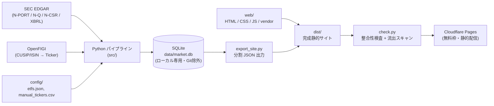

# etf-xray 全体設計書（Draft）

> **目的**: 100% 公開データ（SEC EDGAR + OpenFIGI）のみを用いて、米国 ETF の構成銘柄ヒストリーと個別株ファンダメンタルズ（バフェット・コード風）を閲覧できる静的 Web サイトを構築し、Cloudflare Pages 無料枠で公開する。  
> **リポジトリ配置**: `~/projects/etf-xray`（GitHub Private リポジトリ管理）  
> **UI 言語**: 英語（English）／開発ドキュメント・コメントは日本語

---

## 1. 基本原則

1. **100% 公開データ（再配布クリーン）**
   - 保有明細・財務・配当・基準日株価はすべて **SEC EDGAR**、識別子変換は **OpenFIGI** ＋ 手動対応表のみを使用。
   - Yahoo Finance などの非公式・再配布禁止 API は使用しない。
2. **2 層データモデル（ETF DB × 個別株 DB）**
   - ETF の構成データと個別株の財務・配当データを完全分離する。
   - Phase 1 はまず **SCHD** から始め、DB・JSON・UI は最初からマルチ ETF 前提で設計する。
   - 複数 ETF になると各 ETF の `value_usd ÷ shares` から四半期末株価を相互補完できる。
3. **枯れた最小構成（低メンテナンス・高透明性）**
   - バックエンド・ビルド: **Python 3.10+** + **SQLite**（標準ライブラリ）。
   - フロントエンド: **素の HTML / CSS / ES Modules JS** ＋ 定番チャートライブラリ 1 本をローカル同梱（**Node.js / npm 不要**）。
4. **情報流出防止（Security by Design）**
   - 個人情報（`SEC_USER_AGENT` 等）・認証情報・ローカルパスが Git や公開物へ混入しないよう、機械的な 4 層ガードを最初から組み込む。

---

## 2. システム全体像とデータフロー



---

## 3. ディレクトリ構成

```text
etf-xray/
├── AGENTS.md                   # AI 作業ルール（情報流出防止・禁止操作・検証手順）
├── DESIGN.md                   # 本設計書
├── README.md                   # 環境構築・実行方法
├── .gitignore                  # .env*, data/, dist/, .venv/, *.db 等を厳格除外
├── .env.example                # 環境変数テンプレート（ダミー値のみ）
├── requirements.txt            # Python 最小依存（requests, lxml 等）
├── run.sh                      # 実行スクリプト（setup / build / check / serve 等）
├── config/
│   ├── etfs.json               # 対象 ETF 定義（CIK, Series ID, 使用アダプタ等）
│   └── manual_tickers.csv      # schd-history から移植する手動ティッカー対応表
├── src/
│   ├── edgar.py                # EDGAR クライアント（5 req/s制限・キャッシュ）
│   ├── db.py                   # SQLite スキーマ初期化・接続管理
│   ├── adapters/
│   │   ├── nport.py            # 共通 N-PORT-P（XML）アダプタ（2019〜）
│   │   ├── schwab_legacy.py    # Schwab 旧書類 HTML アダプタ（2011〜2019）
│   │   └── (Phase 2以降) vanguard_legacy.py, uit_legacy.py (DIA等)
│   ├── identify.py             # ティッカー・CIK・security_id 解決
│   ├── fundamentals.py         # SEC XBRL companyfacts 抽出（PL/CF/BS/DPS/分割補正）
│   ├── metrics.py              # 指標計算（TTM・CAGR・連続非減配・基準日PER/PBR/利回り）
│   ├── export_site.py          # SQLite → dist/data/ 分割 JSON 出力
│   ├── check.py                # データ整合性検査 ＋ 情報流出スキャン
│   └── serve.py                # ローカル確認用 HTTP サーバー
├── web/
│   ├── index.html              # SPA シェル（#/etf/SCHD, #/stock/KO 等）
│   ├── _headers                # Cloudflare Pages セキュリティヘッダ（CSP 等）
│   ├── css/style.css
│   ├── js/
│   │   ├── app.js              # ルーター・共通状態
│   │   ├── api.js              # JSON fetch + キャッシュ
│   │   ├── dom.js              # 安全な DOM 生成（innerHTML 禁止）
│   │   ├── charts.js           # チャート描画ラッパー
│   │   ├── etf-view.js         # ETF ビュー（列カスタマイズ・入替・構成表・保有期間マップ）
│   │   └── stock-view.js       # 個別株ビュー（年次グラフ ＋ 年次数値テーブル）
│   └── vendor/
│       └── echarts.min.js      # チャートライブラリ 1 本をローカル同梱（または chart.umd.min.js）
├── scripts/
│   └── pre-commit              # Git フック（秘密情報・禁止ファイル検出でコミット阻止）
├── data/                       # [Git除外] raw/（EDGARキャッシュ）, market.db（SQLite）
└── dist/                       # [Git除外] 公開用ビルド成果物（web/ + 生成 JSON）
```

---

## 4. データベース設計（SQLite: `data/market.db`）

### 4.1 ETF 構成 DB

| テーブル | 主キー | 主なカラム |
|---|---|---|
| `etfs` | `etf_id` | `name`, `issuer`, `cik`, `series_id`, `structure` (`open_end` / `uit`), `fiscal_year_end_month`, `active` |
| `etf_dates` | `(etf_id, as_of)` | `holdings_count`, `total_value_usd`, `source`, `accession` |
| `etf_holdings` | `(etf_id, as_of, security_id)` | `ticker`, `reported_name`, `shares`, `value_usd`, `weight`, `pct_net_assets`, `rank`, `prev_weight`, `is_new` |
| `etf_changes` | `(etf_id, as_of, kind, security_id)` | `kind` (`add` / `remove`), `ticker`, `name`, `weight` |

### 4.2 個別株 DB

| テーブル | 主キー | 主なカラム |
|---|---|---|
| `securities` | `security_id` | `ticker`, `name`, `cusip`, `isin`, `cik`, `ticker_source`, `first_seen`, `last_seen` |
| `quarter_prices` | `(security_id, as_of)` | `price_usd`（`value_usd / shares`）, `source_etf` |
| `financials_annual` | `(security_id, fy_end)` | `fy_start`, `filed`, `revenue`, `operating_income`, `net_income`, `eps_diluted`, `shares_diluted`, `shares_outstanding`, `operating_cf`, `capex`, `fcf`, `dividends_paid`, `buybacks`, `total_assets`, `total_equity`, `cash`, `total_debt`, `dps_declared`, `dps_paid`, `split_factor` |
| `financials_ttm` | `security_id` | `period_end`, `revenue_ttm`, `operating_income_ttm`, `net_income_ttm`, `eps_ttm`, `fcf_ttm`, `dps_ttm`, `total_equity`, `shares_outstanding` |
| `stock_metrics` | `security_id` | `latest_price_date`, `latest_price`, `ttm_yield`, `payout_ratio_eps`, `payout_ratio_fcf`, `div_streak_years`, `div_streak_open`, `div_cagr_5y`, `div_cagr_10y`, `rev_cagr_5y`, `op_margin`, `roe`, `equity_ratio`, `fcf_margin`, `pe_ratio`, `pb_ratio`, `data_notes` |

### 4.3 SEC XBRL 抽出の設計ポイント（Phase 1 冒頭で実データ検証）
- **タグ優先順位マッピング**: 業種（一般事業会社・銀行・保険等）や会計基準（US-GAAP / IFRS）ごとのタグ揺れを優先度テーブルで吸収する。
- **Yahoo なしでの株式分割補正**: 複数年の 10-K に重複記載される同一 `fy_end` の EPS / 加重平均株式数の比率を連鎖させ、過去年度の 1 株指標（EPS / DPS）を最新株数基準へ揃える。
- **配当性向の安定化**: 同一決算期内の `DPS ÷ EPS` および総額ベースの `DividendsPaid ÷ NetIncome`（`÷ FCF`）を用いるため、株式分割によるズレが生じない。
- **連続非減配年数**: XBRL 義務化以降（2009〜2011年頃〜、最大約 15 年）で判定し、開始時点から減配なしの場合は `15+ yrs` 等で明示する。

---

## 5. Web 配信用 JSON 設計（Cloudflare Pages 最適化）

| パス | 内容 | サイズ目安 |
|---|---|---|
| `dist/data/meta.json` | ビルド日時、ETF 一覧、出典・免責情報 | 数 KB |
| `dist/data/etf/<ETF_ID>/summary.json` | 基準日一覧、入替推移、保有期間マップ用データ | 50〜150 KB |
| `dist/data/etf/<ETF_ID>/holdings/<AS_OF>.json` | 選択基準日の構成銘柄一覧 | 10〜50 KB / 回 |
| `dist/data/stocks/index.json` | 全銘柄の最新指標サマリー（ETF 表の列切替・銘柄検索用） | 100〜300 KB |
| `dist/data/stocks/<SECURITY_ID>.json` | 個別株詳細（年次 PL/CF/BS/配当履歴・基準日株価・保有 ETF 推移） | 5〜15 KB / 銘柄 |

- 個別株の詳細は開いた銘柄だけオンデマンド `fetch` するため、銘柄数が増えても初期表示が高速。
- Cloudflare Pages 無料枠の上限（1 ファイル 25 MiB、合計 20,000 ファイル、帯域無制限）に対して十分な余裕がある。

---

## 6. UI 構成（英語・プロトタイプを見ながら詳細調整）

1. **ETF View（`#/etf/SCHD`）**
   - ETF セレクタ、基準日セレクタ、サマリータイル、入替推移グラフ、保有期間マップ
   - **構成銘柄テーブル（列カスタマイズ UI 付き）**: 固定列（Rank, Ticker, Company, Weight, QoQ）に加え、Dividend / Fundamentals / Valuation の各指標列をプリセット切替＆個別 ON/OFF 可能
   - 銘柄クリックで詳細プレビュー、または Stock View へ遷移
2. **Stock View（`#/stock/KO` — バフェット・コード風）**
   - ヘッダー＆サマリーカード（最新基準日株価・利回り・PER・PBR・配当指標・保有 ETF バッジ）
   - **年次推移グラフ（Visual）** と **年度別数値一覧（Table）** の両方を切り替え／併設表示：
     - Earnings (PL) / Cash Flow (CF) / Balance Sheet (BS) / Dividends / ETF Ownership

---

## 7. セキュリティ・情報流出防止設計（4 層防御）

| 層 | 仕組み | 防ぐ事故 |
|---|---|---|
| **1. リポジトリ設定** | GitHub **Private** リポジトリ（Cloudflare Pages は Private からも無料デプロイ可）＋ 厳格な `.gitignore` | `.env`・キャッシュ・SQLite DB・鍵ファイルの誤コミット |
| **2. 自動スキャン（`check.py`）** | ビルド時・検査時にリポジトリ対象ファイルと `dist/` 全文を走査し、**メールアドレス・`SEC_USER_AGENT` 実値・APIトークン形式・ローカルパス（`/Users/` 等）**を 1 件でも検出したら失敗終了 | 連絡先・トークン・ローカル環境の公開サイトや Git への混入 |
| **3. Git `pre-commit` フック** | `scripts/pre-commit` でコミット対象差分を自動スキャンし、危険な差分や除外漏れファイルのコミットをブロック | コミット時点での流出防止 |
| **4. ブラウザ & AI ルール** | `web/_headers` で厳格な CSP（`default-src 'self'` 等、外部通信遮断）、`innerHTML` 禁止、`AGENTS.md` で `git push`・公開操作・`.env` 読み取りの禁止/人間承認必須を明文化 | XSS・外部スクリプト改ざん・AI による意図しない push や情報露出 |

---

## 8. 開発フェーズ

- **Phase 0（土台）**: `~/projects/etf-xray` で Git 初期化、Python 3.10+ 環境構築、`AGENTS.md`・`DESIGN.md`・`.gitignore`・`pre-commit` 導入。
- **Phase 1（SCHD 100% SEC 版 MVP）**:
  1. 代表 15〜20 銘柄で SEC XBRL 抽出（PL/CF/BS/DPS/分割補正）を実データ検証し、`schd-history` の既存値と比較。
  2. SCHD 全期間（`schwab_legacy.py` + `nport.py`）＋個別株 DB → 分割 JSON 生成 → `check.py` 合格。
  3. 英語 UI（ETF View + Stock View のグラフ＆表）を作成し、ブラウザで見ながら UI を改善。
  4. Cloudflare Pages で公開。
- **Phase 2（マルチ ETF 拡張）**: `config/etfs.json` による N-PORT ETF 追加（VYM / HDV / VOO 等）、`vanguard_legacy.py`（2011〜）、`uit_legacy.py`（DIA 等）。
- **Phase 3（横断分析）**: ETF 間重複（Overlap）比較、カスタムポートフォリオ合成、CSV ダウンロード。
