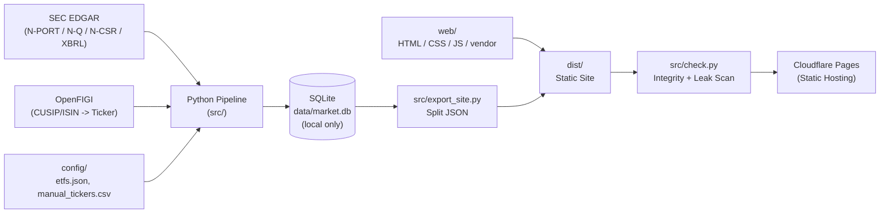

# etf-xray

A static web application and Python data pipeline for exploring U.S. ETF constituent histories and individual stock fundamentals/dividend metrics using **100% public data** (**SEC EDGAR** + **OpenFIGI**).

- **Live site**: https://etf-xray.pages.dev
- **Covered ETFs**:
  - **VYM** — Vanguard High Dividend Yield ETF (`2011-01` – present)
  - **VOO** — Vanguard S&P 500 ETF (`2011-03` – present)
  - **SCHD** — Schwab U.S. Dividend Equity ETF (`2011-11` – present)
  - **HDV** — iShares Core High Dividend ETF (`2019-10` – present)
- **Data sources**: SEC EDGAR (`N-PORT-P`, `N-CSR`, `N-CSRS`, `N-Q`, `10-K`, `10-Q` XBRL CompanyFacts) and OpenFIGI (+ curated `config/manual_tickers.csv`)
- **Frontend**: Vanilla HTML / CSS / ES Modules JS + locally bundled Chart.js (zero Node.js/npm dependencies, zero external CDNs, strict CSP)

---

## Architecture



- **Two-layer SQLite model (`data/market.db`, gitignored)**:
  - **ETF layer**: `etfs`, `etf_dates`, `etf_holdings`, `etf_changes`
  - **Equity layer**: `securities`, `quarter_prices` (implied from `value_usd / shares`), `financials_annual`, `financials_quarterly`, `financials_ttm`, `stock_metrics`
- **Split static JSON (`dist/data/`, gitignored)**:
  - `meta.json`, `etf/<ETF_ID>/summary.json`, `etf/<ETF_ID>/holdings/<AS_OF>.json`, `stocks/index.json`, and on-demand `stocks/<SECURITY_ID>.json`

---

## Quick Start

**Prerequisites**: Python 3.10+ and Git (no Node.js required).

```bash
# 1. Create virtual environment and install minimal dependencies
python3 -m venv .venv
.venv/bin/pip install -r requirements.txt

# 2. Enable the secret/PII leak-prevention pre-commit hook
git config core.hooksPath scripts

# 3. Create your local .env file (excluded by .gitignore)
cp .env.example .env
```

Open `.env` and set `SEC_USER_AGENT` to your own app/name and contact email as required by SEC EDGAR fair-access guidelines. Never commit `.env`.

---

## Usage

```bash
# Full pipeline: fetch SEC filings -> extract XBRL -> compute metrics -> build dist/
./run.sh build

# Fast offline rebuild from local cache (skip ETF re-fetch)
./run.sh build --skip-etf --offline

# Re-export dist/ (static assets + split JSON) from existing SQLite DB
./run.sh export

# Run data integrity checks + secret/PII leak scan (required before commit/deploy)
./run.sh check

# Serve dist/ locally with production CSP headers (http://127.0.0.1:8787/)
./run.sh serve

# Deploy dist/ directly to Cloudflare Pages via Direct Upload API (requires token in .env)
./run.sh deploy
```

---

## Deploying to Cloudflare Pages

Only the built `dist/` directory is published (`data/` and `.env` are gitignored and never uploaded).

- **Option A — Direct Upload via Python (`./run.sh deploy`)**:
  Create a scoped Cloudflare API token with only **Account → Cloudflare Pages: Edit**, set `CLOUDFLARE_API_TOKEN`, `CLOUDFLARE_ACCOUNT_ID`, and `CLOUDFLARE_PAGES_PROJECT` in `.env`, then run `./run.sh deploy`. It runs `./run.sh check` automatically and uploads only changed files using differential content hashing.
- **Option B — Cloudflare Dashboard**:
  Run `./run.sh check`, then drag and drop the `dist/` folder into **Workers & Pages → Direct Upload**.

---

## Directory Structure

| Path | Purpose |
| :--- | :--- |
| `config/` | Target ETF definitions (`etfs.json`) and curated ticker overrides (`manual_tickers.csv`) |
| `src/` | EDGAR client, `N-PORT-P` / Schwab / Vanguard legacy adapters, entity resolution, XBRL extraction, metrics, static export, integrity checks, local server, and Cloudflare deployer |
| `web/` | Static frontend (HTML / CSS / ES Modules JS, `_headers` CSP rules, locally bundled `vendor/chart.umd.min.js`) |
| `scripts/pre-commit` | Git hook blocking secrets, personal info, and ignored artifacts from being committed |
| `data/` | *[Gitignored]* Cached SEC/OpenFIGI responses and local SQLite database (`market.db`) |
| `dist/` | *[Gitignored]* Final deployable static site (`web/` + generated JSON) |

---

## Security & Privacy

- **Zero secrets in Git or `dist/`**: `.gitignore`, `scripts/pre-commit`, and `src/check.py` scan tracked files and generated build artifacts for API tokens, private keys, personal emails, and local filesystem paths.
- **Strict frontend hardening**: Vanilla JS using `textContent` / safe DOM builders only (no `innerHTML` / `outerHTML` / `insertAdjacentHTML`), no external CDN scripts, and a strict `Content-Security-Policy` in `web/_headers`.

---

## Data Sources & Disclaimer

All figures are programmatically compiled from public SEC EDGAR filings and OpenFIGI metadata. Quarter-end share prices are implied from reported ETF holding market values divided by share counts (`value_usd / shares`). This project is for informational purposes only and does not constitute investment advice.

---

## License

[MIT](LICENSE)

